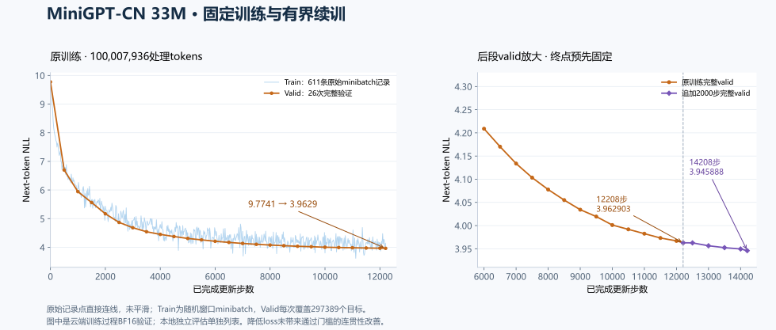

# MiniGPT-CN

从零实现并训练约33M参数的中文Decoder-only Transformer，完成BPE、训练恢复、完整评估和本地推理的工程闭环。

**[项目展示](docs/showcase.md) · [模型卡](MODEL_CARD.md) · [本地复现](docs/local-reproduction.md) · [目录与文档导航](docs/README.md)**

这是中文文本续写实验。生成仍会重复、离题和句意混乱；展示真实结果和限制，不宣称可靠聊天、指令遵循或事实准确性。



## 实现与运行

- Transformer：8层/8头，RMSNorm、RoPE、SwiGLU，权重共享与dropout。
- Tokenizer：byte-level BPE增量训练、编解码、保存加载；16000词表含EOS256、15743 merges。
- 训练：AdamW、BF16前向/FP32参数、完整valid含尾块、周期保存与恢复。
- 恢复：保留优化器、采样器及RNG；同环境受控恢复已验证，跨版本不绕过恢复契约。
- 推理：greedy、temperature/top-p、EOS，可选KV Cache和重复惩罚；滑窗重建保持既有语义。
- 实验：原12208步固定训练、独立valid/test、全部12条预定续写和固定2000步续训对照。

## 真实实验结果

| 项目 | 结果 |
| --- | --- |
| 实际参数 | 33104384，embedding/LM head共享 |
| 模型规格 | V16000 / context512 / L8 / H8 / d512 / d_ff1344 |
| 冻结train | 73520篇 / 48187994个token位置 |
| 原训练 | 12208步 / 100007936处理tokens，约2.075倍算术曝光 |
| 原final本地valid | loss3.962893 / PPL52.6093，297389个目标 |
| 原final本地test | loss3.995780 / PPL54.3682，251516个目标 |
| 生成质量 | 12条完整固定样例存在重复/离题，质量未通过 |
| 有界续训 | 同环境valid降低0.017009；18对仅1改善/12无明确变化/5变差，未通过连贯性门槛 |

曲线中的train是611条原始minibatch记录，valid为完整验证；图中云端训练指标与本地独立评估分别注明。约1亿处理tokens不等于1亿唯一语料token，曝光比例也不是完整epochs。
原12208步final继续作为展示/复现基线，14208步权重保留作对照。全部6个提示词×greedy/sampling的12条原样输出见[展示页](docs/showcase.md#固定续写全部12条)，优化方法与边界见[M3收尾](docs/m3-closeout.md)。

## 本地体验

现有Windows项目环境为`.venv`，WSL项目环境为`/home/luoyu/.venvs/minigpt-cn`。已有准确版本权重/tokenizer后，按[本地复现](docs/local-reproduction.md)核对SHA并运行CPU最小命令；CUDA续写可选。
**仓库不包含权重、tokenizer产物或数据下载包。** 只有代码的新克隆不能直接生成；缺产物时不自动换词表、训练替代模型或启动云作业。
M4文档命令的CPU8-token生成已实际执行，PowerShell5.1/7语法通过；它验证命令与文件链路，不代替质量评估。推理不需要原云端绝对路径或训练数据，精确续训仍受原版本/配置/数据契约约束。

在项目根目录打开PowerShell，完成上述产物核对后，可反复输入自己的续写前缀（下例使用CUDA/BF16）：

```powershell
while ($true) {
    $m4Prompt = Read-Host '输入续写前缀（/exit退出）'
    if ($m4Prompt -eq '/exit') { break }
    if ([string]::IsNullOrWhiteSpace($m4Prompt)) { continue }
    & .\.venv\Scripts\python.exe -B -m minigpt_cn.inference.generate `
      --checkpoint 'logs/m3_training_report/m3_pretrain_100m_return_v1/ckpt_final.pt' `
      --tokenizer 'data/processed/pilot_tokenizer_16k_v1.json' `
      --prompt $m4Prompt --max-new-tokens 128 `
      --device cuda --precision bfloat16 --seed 42 `
      --temperature 0.8 --top-p 0.9 --repetition-penalty 1.0
    if ($LASTEXITCODE -ne 0) { break }
}
```

仅用CPU时，将`--device cuda --precision bfloat16`改为`--device cpu --precision float32`。用户已完成自由提示词试用；这些输出用于观察续写表现，不能单独证明泛化能力或总体生成质量。

## 项目结构

```text
src/minigpt_cn/       模型、BPE、训练、评估与生成
configs/             模型结构和固定实验配置
tests/               CPU可运行的实现与恢复等测试
scripts/             已有记录的离线展示材料构建
docs/                实验结果、展示、复现与阶段交接
docs/assets/         本项目派生的PNG/SVG训练曲线
data/                来源说明与本地数据产物（产物Git忽略）
checkpoints/         本地训练权重（Git忽略）
logs/                运行/验收/回传产物，含部分权重（Git忽略）
```

数据工具已收尾并冻结扩建，保留代码供按需复用；不再以维基模板、全站扫描或通用审批平台作为主线。旧pilot/2048词表和权重原样保留，不混用新16K token ID。

## M5本地结构标注体验

M5已完成独立Qwen3-0.6B LoRA工程实验，模型质量尚未达标。打开[GitHub交付与本地查看说明](docs/m5-github-closeout.md)，或在现有WSL M5环境运行：

```bash
bash /mnt/d/aiworkspace/transformer/scripts/m5_demo_wsl.sh --text 'Definition: A metric is a function.' --run
```

不加`--run`只检查。最后step105的训练、评测、模型位置和限制见[M5收尾报告](docs/m5-closeout.md)。

## 阶段状态

| 阶段 | 状态 |
| --- | --- |
| M0–M2 | 核心实现、16K tokenizer与33M短训练/恢复闭环已验收 |
| M3 33M Pretraining | 固定训练、评估与优化实验已收尾；保留原final基线和生成质量限制 |
| M4 Portfolio Release | 展示页、图、模型卡与本地复现已发布；用户完成自由提示词试用，[PR #6](https://github.com/IniJyou/minigpt-cn/pull/6)已合并 |
| M5 LoRA Chat and Evaluation | [已收尾](docs/m5-closeout.md)：本地推理、LoRA训练/恢复与53次最终评测完成；模型质量未达接纳门槛，test封存；提供完整对照查看器和手动推理入口 |

**继续任务先读[当前工作与交接](docs/current-work.md)，这是唯一下一任务入口。** 协作与Git操作约定见[AGENTS.md](AGENTS.md)。本轮M5由用户明确授权提交与推送，Git交付范围见[交付说明](docs/m5-github-closeout.md)。

## 文档与检查

- [完整目录与文档导航](docs/README.md)：按当前M5、33M成果、接口参考和历史实验分类。
- [当前工作](docs/current-work.md)、[M5任务与样本规范](docs/m5-task-spec-v1.2.md)、[阶段路线](docs/learning-roadmap.md)。
- [模型卡](MODEL_CARD.md)、[展示页](docs/showcase.md)、[本地复现](docs/local-reproduction.md)、[M3收尾](docs/m3-closeout.md)。
- [运行接口](docs/runtime-reference.md)、[数据状态](data/README.md)；其他已完成实验的步骤从分类导航按需查阅。

已有Windows环境的检查命令：

```powershell
$env:CUDA_VISIBLE_DEVICES = '-1'
.\.venv\Scripts\python.exe -m ruff check .
.\.venv\Scripts\python.exe -m pytest -q --tb=short
```

历史完整CPU回归为Windows736 passed/10 skipped、WSL741 passed/5 skipped，两边Ruff通过。M4交付时另做展示构建、结果/文档核对与Ruff；本次README更新不重跑模型或完整回归。历史原始检查见[M3收尾记录](docs/m3-closeout.md#本轮检查)。

## 许可与发布边界

项目源码为[MIT](LICENSE)。上游数据集的CC BY-SA 3.0/GFDL声明与代码许可分别记录，不在这里给模型权重作统一许可声明。
原始语料、token分片、tokenizer、checkpoint、日志、缓存和密钥不提交Git。本轮仅展示代码、配置、派生图和已记录文本样例，不公开权重/数据。独立学习笔记`CS336_note.md`和作业仓库不修改。
