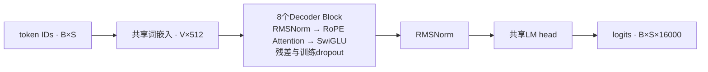

# MiniGPT-CN 33M：从实现到真实训练

从零实现中文Decoder-only Transformer，完成BPE、固定训练、保存/恢复、独立评估与受控优化。工程链路已完成；生成仍有循环、离题与句意混乱，本页原样展示结果。

[模型卡](../MODEL_CARD.md) · [本地复现](local-reproduction.md) · [M4验收入口](m4-acceptance.md) · [M3完整实验报告](m3-experiment-report.md)

## 项目成果

| 范围 | 已完成 |
| --- | --- |
| 模型核心 | 8层/8头，33104384参数，RMSNorm/RoPE/SwiGLU，权重共享、dropout |
| Tokenizer | byte-level BPE增量训练、保存加载；16000词表含EOS256，15743 merges |
| 训练与评估 | AdamW、混合精度、完整valid尾块覆盖、周期保存、优化器/采样器/RNG恢复 |
| 推理 | greedy、temperature/top-p、EOS、可选KV Cache与重复惩罚，滑窗重建 |
| 实际运行 | 原12208步/100007936处理tokens，另做固定2000步续训对照 |
| 当前边界 | 中文文本续写实验；未做指令微调，连贯性与事实性未验收 |

最终train为73520篇/48187994个token位置，来源固定中文Wikipedia版本；约2.075倍算术曝光，不是1亿唯一语料token。6个源分片已按有界规则处理，不代表逐文档事实、语义或许可批准。

## 模型结构



S最多512；输入与目标只右移一次。结构与计算入口见[运行参考](runtime-reference.md)。

## 真实训练曲线


[PNG图片](assets/training-loss.png) · [SVG矢量图](assets/training-loss.svg)

左图为611条原始train minibatch loss与26次完整valid；右图放大6000步以后的完整valid，并展示追加2000步的6次valid。每次valid覆盖297389目标，未平滑或挑选点。Train/valid上下文与统计范围不同，曲线间距不直接当作泛化差距。

图中云端原final valid=3.962902672139143，续训final=3.9458879316974587。下面是同一PC独立评估，精度/环境差异如实区分。

## 原final独立评估

| 集合 | 完整目标 | loss | perplexity |
| --- | ---: | ---: | ---: |
| valid | 297389 | 3.962893003020671 | 52.609304883285425 |
| test | 251516 | 3.9957795353415366 | 54.3682060470648 |

Windows/Python3.12.4/PyTorch2.14.0+cu126，RTX4060 Laptop，BF16；不是本轮重跑的分数。test用于原模型一次报告，没有用于选权重、延长或优化对照。PPL只在本数据/词表/协议内解释，不与不同评测直接排名。

## 固定续写：全部12条

按原协议顺序列出6个提示词×greedy/sampling全部结果。每条保留完整续写、原长度和停止原因；没有挑最好结果。sampling为seed42、temperature0.8/top-p0.9；两模式均BF16、无缓存、最多128新token，重复惩罚保持默认1.0。

<details>
<summary>01 · geography / greedy · 128 token · max_new_tokens</summary>

提示词：`北京是中国的`

实际新增128 token，停止=max_new_tokens，非法UTF-8=False。

```text
“北京”地区，是北京地区最大的城市。

历史

北京

北京

北京

北京

北京

北京

北京

北京

北京

北京

北京

北京

北京

北京

北京

北京

北京

北京

北京

北京

北京

北京

北京

北京

北京

北京

北京

北京

北京

北京

北京

北京

北京

北京

北京

北京

北京

北京
```

</details>

<details>
<summary>02 · geography / sampling · 128 token · max_new_tokens</summary>

提示词：`北京是中国的`

实际新增128 token，停止=max_new_tokens，非法UTF-8=False。

```text
台，又称“上海八三”或“上海八三”。该制程自 1930 年开始，由上海（上海）出资，为上海“五三”产。

1930 年代，上海和上海第一品牌的上海八三与上海五三在上海成立。上海八三于 1935 年推出，该制程自 1935 年开始生产。

1933 年，上海八三在上海成立上海八三公司。1935 年，上海八三随上海、上海八三于 1935 年推出，该制程自 1950 年开始生产。

参见
```

</details>

<details>
<summary>03 · history / greedy · 128 token · max_new_tokens</summary>

提示词：`中国的历史可以追溯到`

实际新增128 token，停止=max_new_tokens，非法UTF-8=False。

```text
公元前3世纪。

在公元3世纪，中国在中国的建立，在公元3世纪，中国在中国的建立，在公元3世纪，中国在中国的建立，在公元3世纪，中国在中国的建立，在公元3世纪，中国在中国的建立，在公元3世纪，中国在中国的建立，在公元3世纪，中国在中国的建立，在公元3世纪，中国在中国的建立，在公元3世纪，中国在中国的建立，在公元3世纪，中国在中国的建立，在公元3世纪，中国在中国的建立，在公元3世纪，中国在中国的建立，在公元
```

</details>

<details>
<summary>04 · history / sampling · 128 token · max_new_tokens</summary>

提示词：`中国的历史可以追溯到`

实际新增128 token，停止=max_new_tokens，非法UTF-8=False。

```text
公元前九世纪。

在西汉时期，Richard Morhaser和Richard Morhaser（很可能是Brocker）曾被认为是所有存在于新英格兰、新英格兰和英格兰的殖民地。Sean Huntor也存在著爱尔兰以及爱尔兰。

在18世纪，Robert Morhaser与Richard Morhaser的后来与Robert Morhaser（Jones Painters）一同于18世纪建立。

今日的Lips, Da't I, Your Wilhel
```

</details>

<details>
<summary>05 · astronomy / greedy · 128 token · max_new_tokens</summary>

提示词：`太阳系中，地球`

实际新增128 token，停止=max_new_tokens，非法UTF-8=False。

```text
轨道轨道轨道轨道轨道轨道轨道轨道轨道轨道轨道轨道轨道轨道轨道轨道轨道轨道轨道轨道轨道轨道轨道轨道轨道轨道轨道。

轨道轨道轨道

轨道轨道轨道

轨道轨道轨道

轨道轨道轨道

轨道轨道

轨道轨道

轨道轨道

轨道轨道

轨道轨道

轨道轨道

轨道轨道

轨道轨道

轨道轨道

轨道轨道

轨道轨道

轨道轨道

轨道轨道

轨道轨道

轨道轨道

轨道轨道

轨道轨道

轨道轨道

轨道轨道

轨道轨道
```

</details>

<details>
<summary>06 · astronomy / sampling · 128 token · max_new_tokens</summary>

提示词：`太阳系中，地球`

实际新增128 token，停止=max_new_tokens，非法UTF-8=False。

```text
大气层中存在太阳表面，以及表面为小雪点。

当太阳表面的气流和大气对辐射产生（尤其是重力系统）时，地球的辐射光度称为流星。

在两个星期内，地球大气层中的气体粒子的辐射与地球存在表面的影响，在整个水体的地球表面和大气层的冰层间存在不同相等的超热现象。

参考资料

外部连结

https://web.archive.org/web/200508081612/http://www.parmaciena.
```

</details>

<details>
<summary>07 · technology / greedy · 18 token · eos</summary>

提示词：`计算机是一种`

实际新增18 token，停止=eos，非法UTF-8=False。

```text
计算机计算机，它可以用来描述计算机计算机。

计算机计算机
计算机计算机<|endoftext|>
```

</details>

<details>
<summary>08 · technology / sampling · 128 token · max_new_tokens</summary>

提示词：`计算机是一种`

实际新增128 token，停止=max_new_tokens，非法UTF-8=False。

```text
计算机，一种计算机计算机，可将计算机上RC用原始程序制程运行。

技术原理
计算机（RC）网络允许用户可以通过DTL来实现计算机运行，以防止用户进入和进入SAL。

CLDF
CLDF是由Adobe Concerd和Phylogenck开发的。CLDF后来与CLDF混淆。CLDF技术由Blacksteiner于2014年发布。

CLDF

CLDF是CLDF的创始人，
```

</details>

<details>
<summary>09 · biology / greedy · 128 token · max_new_tokens</summary>

提示词：`植物通过光合作用`

实际新增128 token，停止=max_new_tokens，非法UTF-8=False。

```text
，并用植物和植物来生长。

植物

植物

植物

植物

植物

植物

植物

植物

植物

植物

植物

植物

植物

植物

植物

植物

植物

植物

植物

植物

植物

植物

植物

植物

植物

植物

植物

植物

植物

植物

植物

植物

植物

植物

植物

植物

植物

植物

植物


```

</details>

<details>
<summary>10 · biology / sampling · 128 token · max_new_tokens</summary>

提示词：`植物通过光合作用`

实际新增128 token，停止=max_new_tokens，非法UTF-8=False。

```text
将植物生长至北部，它们在早期就可以在植物中生长，以防止植物。

植物对植物的生长很重要，人类会聚集在一起，而植物的生长速度可能到达成熟植物和植物，并且会代谢或植物生长。植物与植物之间的生长可能由植物生长，并生长于植物中。

植物生长
植物在植物培养过程中会发出不同的功能，这些功能在植物上不同，并且可以接受植物生长。植物生长在植物生长过程中会作出不同的作用。植物的生长缓慢，令植物生长在土壤中，可以传播植物生长到营养上。植物
```

</details>

<details>
<summary>11 · traditional_chinese / greedy · 128 token · max_new_tokens</summary>

提示词：`臺灣位於`

实际新增128 token，停止=max_new_tokens，非法UTF-8=False。

```text
臼臼，体长可达2.5公分。

分布
本鱼分布于印度西太平洋区，包括印度、印度、印度、印度、印度、印度、印度、印度、印度、印度、印度、印度、印度、印度、印度、印度、印度、印度、印度、印度、印度、印度、印度、印度、印度、印度、印度、印度、印度、印度、印度、印度、印度、印度、印度、印度、印度、印度、印度、印度、印度、印度、印度、印度、印度、印度、印度、印度、印度、印度、印度
```

</details>

<details>
<summary>12 · traditional_chinese / sampling · 128 token · max_new_tokens</summary>

提示词：`臺灣位於`

实际新增128 token，停止=max_new_tokens，非法UTF-8=False。

```text
「九头八脚八脚八脚八脚八脚八脚八脚八脚八脚八脚八脚八脚八脚八脚八脚八脚八脚八脚八脚八脚八脚八脚八脚八脚八脚八脚八脚八脚八脚八脚八脚八脚八脚八脚八脚七脚八脚八脚八脚八脚八脚八脚八脚八脚八脚八脚八脚八脚八脚七脚八脚八脚八脚八脚八脚八脚八脚八脚八脚八脚八脚八脚八
```

</details>

这12条续写存在明显重复/离题/句意混乱，生成质量未通过。折叠仅为方便阅读，不隐藏失败样例；原始ID与本地完整记录仍保留在Git忽略的logs/m3_final_local_evaluation_v1。

## 有界优化：如实保留未改善结论

先做原始预测、缓存与因果前缀检查，再对重复惩罚和固定采样作受控比较。降低表面重复没有得到连贯性通过结论。最后固定原数据/优化器/RNG、最小LR3e-5，只追加2000步，预先约定同时满足valid下降≥0.01与18对连贯性至少10改善/至多3变差。

| 同一PC环境对照 | 原12208步final | 续训14208步final |
| --- | ---: | ---: |
| 完整valid loss | 3.962893003020671 | 3.9458841234747717 |
| 平均完整输出重复token 4-gram | 7.780309% | 7.655319% |
| 剔除EOS后共同长度重复均值 | 6.523893% | 7.704540% |

valid loss下降0.017009，数值门槛通过；全部18对定性审阅为1改善、12无明确整体变化、5变差，连贯性门槛未通过。不是盲评、独立人工或事实准确率，也不宣称未见数据泛化改善。

因此保留原12208步模型为展示/复现基线，续训权重仅保留对照，不继续加步数或搜索解码参数。详细方法与证据见[续训对照](bounded-continuation-execution.md#本地独立对照结果2026-10-15)。

## 在本地体验

已有准确版本权重与tokenizer的用户，按[本地复现](local-reproduction.md)运行CPU最小例子或可选CUDA采样。只有代码的新克隆不含权重、tokenizer或原始日志，不会自动下载/训练替代品。模型身份和适用边界见[模型卡](../MODEL_CARD.md)。

页面与图片可在GitHub直接阅读，也可打开PNG/SVG查看；无需部署服务。代码MIT许可与上游语料/权重的适用条件分别记录，本轮不公开权重或数据。

## 展示材料复建

脚本[scripts/build_showcase.py](../scripts/build_showcase.py)只读取上述固定原始JSON/JSONL，先核对SHA-256，使用已有matplotlib生成两种格式曲线及本页；不导入模型或改写历史记录。默认拒绝已有输出，复建时指定全新输出目录。

```powershell
python scripts/build_showcase.py --output-root logs/m4_showcase_rebuild_v1
```

绘图库只用于离线图形，以上python须指向已有完整Matplotlib绘图环境；模型推理的项目.venv不需要它。本次使用已有本地Matplotlib3.10.8及依赖，没有安装或修改项目环境。复建需要原始日志；没有日志的代码新克隆仍可阅读已提交图片与本页。
